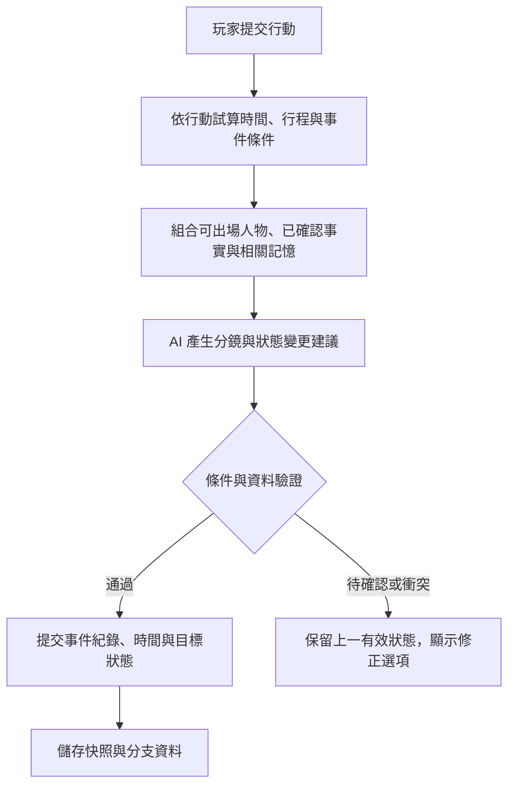

# 已知問題與作者希望的發展方向

[返回 README](../README.md) · [現有功能使用指南](GUIDE.md)

核對日期：2026-11-01。程式基準版本：[7710444](https://github.com/Windd49/ToonCard/tree/7710444ec750da24fb6888ee03b33323cec35ef5)。本頁包含程式檢查、最小案例驗證與建議方案，尚未完成跨模型及長篇遊玩的完整測試。標示「預計」「構想」的介面與功能仍待實作，順序可依實測調整，沒有固定完成日期。

## 已確認的問題與能力缺口

### 1. 文字狀態會被截成開頭數字

已用實際 `parser.js` 模組重現：

| 模型輸出 | 目前解析結果 | 應保留的值 |
|---|---|---|
| `[STAT] 時間 = 08:30` | 數字 `8` | 時間文字 `08:30` |
| `[STAT] 地點 = 3號教室` | 數字 `3` | 地點文字 `3號教室` |

主角／一般狀態的等號解析只取開頭數字；角色專屬狀態使用另一套完整數字判斷，因此相似輸出也可能得到不同型別。依據：[狀態解析](../js/parser.js#L68)。

**目前做法**：檢查狀態欄；必要時編輯該回合訊息，暫用「早上八點半」「三號教室」等不以阿拉伯數字開頭的文字值。**預計修正**：至少只在整個值完全符合數字格式時轉型，再建立文字、數值、劇中時間等欄位定義；增減運算只允許數值型欄位。這是事件與時間軸的前置修正。

### 2. 已整理的摘要可能與改寫後的歷史不一致

已用實際 `engine.js` 模組搭配模擬儲存重現：將「取得紅色鑰匙」改成「尚未取得鑰匙」，或切換該訊息的回覆版本後，既有摘要與摘要涵蓋位置仍保持原值。依據：[切換版本](../js/engine.js#L359)、[編輯訊息](../js/engine.js#L382)。回溯與分支已有部分摘要失效處理，但不足以涵蓋這兩種修改。

**目前做法**：在遊玩選單的「前情提要」手動更正。現行「立即整理」仍按已摘要位置追加整理，不能視為從頭重建全部歷史。**預計修正**：摘要記錄來源訊息及版本；來源更動後，回退到最後有效摘要或由有效歷史重建，並與分支一同保存。

### 3. 繪圖入口的參考圖支援不一致

自動場景在「人物與背景畫在同一張」模式中，僅在 `chat`／`openai` 後端且開啟 `useRef` 時組裝角色參考圖；Gemini／Vertex 底層可接受參考圖，手動立繪與事件圖也有參考圖流程。這是入口整合缺口。依據：[自動場景請求](../js/imagegen.js#L56)、[圖像後端參考圖](../js/imagegen.js#L332)、[手動立繪](../js/sprites.js#L409)。

**目前做法**：需要明確附參考圖時，選擇支援此功能的後端，使用手動立繪／事件圖流程並檢查所選圖片。**預計修正**：統一後端能力表與附圖組裝，送出前顯示已附幾張圖、各自用途及不支援的設定；保留請求紀錄供確認。

### 4. 觸發、目標與相容性需要更明確的邊界

- 世界書已有關鍵字／正則、次要鍵、常駐、機率與遞迴，作用是把內容加入模型提示；目前未保存一次性事件、完成／失敗或計時效果。匯入正規化也未處理 sticky／cooldown／delay 等欄位。預計提供「支援／忽略／待支援」報告及觸發原因。依據：[世界書觸發](../js/worldinfo.js#L22)、[匯入正規化](../js/card.js#L17)。
- 「曾經登場」由歷史訊息累積，無法據此推斷角色當下是否在場；`{{time}}`／`{{date}}` 使用電腦時間，也不是劇中時鐘。預計另外建立在場、位置與劇中時間資料。依據：[狀態推導](../js/engine.js#L20)、[時間巨集](../js/macros.js#L59)。
- 全域成就的回合數會隨成功重新生成等操作累加，分享列表則依玩家訊息數計算。兩者用途不同，不能直接拿來作挑戰排名。特殊場景也可手動插入，單憑顯示圖片不能證明事件已完成。依據：[回合後處理](../js/engine.js#L316)、[分享回合顯示](../js/share.js#L21)、[手動套用場景](../js/views/play.js#L2003)。

## 方向一：事件、主線與 AI 生成草稿

### 已有什麼、還缺什麼

主提示已要求配角主動推進故事，也有「自動進行」。三層優先指示可設定劇情方向、記憶與禁止事項，AI 能構想三個發展方向；這些仍是模型提示，沒有可由程式核對的主線進度或事件狀態。依據：[劇情提示](../js/prompt.js#L6)、[優先指示與構想](../js/priority.js#L57)。

目前可先把重要方向放進「優先指示」，將設定放入常駐或關鍵字世界書。這有助於引導，但無法保證事件只出現一次或一定在指定時機完成。世界書提示的能力邊界也見 [SillyTavern 官方 World Info 說明](https://docs.sillytavern.app/usage/core-concepts/worldinfo/)。

### 希望增加的作者介面

先做事件清單與條件表單，規則穩定後再評估可視化事件圖。每個事件設定：

- 固定 ID、名稱、主線／支線、是否啟用與觸發優先序。
- 前置事件、玩家與角色所在地、回合／劇中時間、需要的數值或已確認事實。
- 一次性、可重複、冷卻、截止時間，以及未觸發／進行中／完成／失敗狀態。
- 固定分鏡或 AI 演出方向、關聯特殊場景、成功與失敗效果，以及玩家能否看見條件。

「AI 產生事件草稿」提供可編輯的條件與分鏡，作者確認後才啟用。「試算」列出已符合和未符合的條件，協助處理事件卡住、互相衝突或無法抵達的節點。

### 預計處理方式與驗收

由程式依已確認狀態選出可觸發事件，再讓 AI 撰寫演出；模型敘述、狀態變更建議與正式事件紀錄分開。可客觀核對的條件由規則判定；依賴語意的條件先列待確認，避免模型一句「已完成」就直接通關。

驗收至少包含：條件未滿足不觸發、一次性事件不重複、前置事件與到期分支正確、回溯後事件紀錄能回復，以及不含事件的舊作品仍可自由遊玩。

## 方向二：有限回合、特殊場景目標與共享挑戰

### 已有什麼、還缺什麼

已能分享作品、素材、選定存檔與主角，也能回頭改選和建立分支；現行分享格式沒有挑戰規則、達標驗證、多人房間或排名服務。依據：[分享內容](../js/share.js#L23)、[分支](../js/engine.js#L404)、[伺服器路由](../server.js#L343)。

### 希望增加的作者與玩家介面

「挑戰設定」讓作者指定同一起點、回合上限、單一必達目標／所有指定目標／任選 N 個不同目標、失敗條件、可否回溯與重新生成。目標綁定事件 ID，特殊場景作為對應演出或獎勵，圖片名稱與顯示次數不作為完成依據。

例如：「20 回合內完成『找回失物』」或「完成三個不同目標，其中必須包含『與守衛和解』」。玩家看到剩餘回合、已完成目標、結果與失敗原因；作者能在分享前試玩成功與失敗路線。

### 預計處理方式與驗收

1. **先做本機挑戰與結果卡**：朋友匯入同一版本，各自遊玩並比較結果。這是非同步玩法，即時同場競賽另需房間與同步機制。
2. **定義挑戰回合**：一次有效提交的玩家行動及採用回覆計一回合；序章不計，自動進行計入，失敗重試不重複扣除。重新生成、改寫、回溯與分支如何處理，須在挑戰開始前明訂並記錄。
3. **保存可攜的規則與紀錄**：挑戰 ID、版本、起點與規則摘要、目標 ID、已採用行動與結果一同匯出；區別各裝置重建的本機 ID。事件達成只登記一次，回合與目標隨分支快照或回放恢復。
4. **最後評估選用的線上排行榜**：先區分本機／自報結果與伺服器驗證結果。可信排名需要伺服器主持或核對可驗證的遊玩流程，僅上傳可自行修改的 JSON 分數不足以證明成績。模型、版本與設定也應記錄，仍無法保證不同模型的難度相同或輸出可重現。

驗收包含：重複顯示／手動插入同一張 CG 不增加目標數、失敗重試不重複扣回合、規則版本不同不混榜。未來如新增雲端功能，需由玩家選擇參與並清楚列出上傳資料；私人完整劇情不應預設公開。

有限回合能讓玩法更集中、降低故事無限延伸的機會，但每回合仍可能很長，摘要也可能遺漏；它不能取代記憶與一致性管理。

## 方向三：人物出場、劇中時間與行程

### 已有什麼、還缺什麼

已有角色池、別名、角色設定、曾登場名單與模型輸出的時間、地點、行程。但沒有統一管理各人物目前位置、在做的事、抵達時間和出場條件，也沒有依規則結算的截止日。單靠 `[STAT]` 文字不足以作可靠排程。

### 希望增加的介面與規則

「世界狀態」面板設定故事起始時間與時間推進方式；「人物行程」按角色列出目前位置、活動、目的地、預定到達／離開時間、可出場條件與玩家是否知情。作者可查看完整排程，玩家只看到應被揭露的情報。

第一版可採作者定義的行動耗時，或每個有效回合推進固定時間；對話、移動與等待的耗時需可調整。一次性事件和有截止日的任務共用事件紀錄，不使用電腦實際日期作故事時間。

例：小夏 08:00～09:00 在車站，09:00 後前往學院；玩家收到邀請後，在 09:00 前到車站才能觸發重逢。到期可出現「錯過約定」分支。倒數與後果用來製造急迫性，規則保證到期會結算，玩家仍可成功、失敗或放棄。

驗收包含：人物無法在不相容位置同時出場、尚未解鎖角色不提前揭露、跨日與同時到期事件有固定處理順序，存檔、回溯與分支能回復當時的時間與行程。

## 方向四：減少幻覺、記憶與各種畫風的提示詞建構

### 已有什麼、還缺什麼

已有自動前情提要、手動編輯摘要、AI 整理「要記住的事」、統一角色名與狀態提示；摘要仍會逐次改寫，缺少事實來源、矛盾檢查與相關原文檢索。依據：[摘要更新](../js/engine.js#L430)、[摘要提示](../js/prompt.js#L250)、[摘要介面](../js/views/play.js#L2040)。

畫風已有動漫、韓漫、黑白漫畫、電影寫實、厚塗、水彩、像素與自訂，手動生成也有參考圖、提示詞編輯和外觀保持選項。需要改善的是跨入口、作品與模型的一致性。依據：[畫風預設](../js/imagegen.js#L6)、[畫風組合](../js/imagegen.js#L47)、[生成編輯面板](../js/sprites.js#L571)。

### 希望增加的故事記憶介面

將「已確認事實」「目前狀態」「未完成約定」「AI 提議的變化」分開，附來源回合；玩家可釘選、更正或拒絕。時間、地點、人物是否存在及事件前置條件先作程式檢查，語意矛盾則提供來源與修正選項，避免錯誤自動覆蓋已確認資料。

關鍵事實優先加入提示，長篇再評估分層摘要與相關原文檢索；保留原文與來源版本，測量錯誤率、提示長度、延遲及費用。模型或檢索都可能出錯，因此目標是降低錯誤與方便修正，不承諾消除幻覺。相關能力與限制見 [SillyTavern Summarize](https://docs.sillytavern.app/extensions/summarize/) 與 [Chat Vectorization](https://docs.sillytavern.app/extensions/chat-vectorization/)。

### 希望增加的畫風與提示詞介面

- 分欄管理作品畫風、角色身份／外貌、服裝姿勢、場景內容、構圖與負面條件；作品級自訂畫風可獨立保存。
- 區分角色參考與畫風參考，清楚設定哪些特徵要保留、哪些要改變，並提示衝突的要求。
- 按後端／模型保存適用範本，顯示最後送出的提示詞與實際參考圖；不支援的負面提示、參考圖或 seed 需明示。
- 記錄模型、提示詞、參考圖與模型支援的 seed 等生成設定，方便重畫和比對；固定 seed 也不保證跨模型結果相同。

驗收包含：作品畫風彼此獨立、不同繪圖入口套用同一份已選設定、能確認後端是否確實收到參考圖，且使用者可以在送出前檢查最終提示。共用提示、角色提示與畫風預設的分層可參考 [SillyTavern Image Generation](https://docs.sillytavern.app/extensions/stable-diffusion/)。

## 建議實作順序與資料流程

| 階段 | 預計內容 | 先確認的結果 |
|---|---|---|
| 1. 資料一致性 | 修正狀態型別、摘要失效重建及繪圖能力提示。 | 改寫歷史後不沿用失效摘要，時間與地點保留正確值。 |
| 2. 最小事件與世界狀態 | 事件表單、條件試算、劇中時間與簡單人物行程。 | 可觸發、錯過、失敗、存檔及回溯，並能說明原因。 |
| 3. 共享挑戰與作者工具 | 本機挑戰、版本化分享、結果卡；擴充故事記憶與畫風範本。 | 同一挑戰可互相分享、目標不重複計數，保留舊作品相容性。 |
| 4. 線上功能評估 | 選用的競賽、成績驗證與排行榜。 | 先定義公平性、資料範圍、作弊處理與維護成本，再決定服務形式。 |

以下是尚待實作的建議流程：

這套規劃希望讓自由演出、作者規則與玩家選擇能共存。新增功能應採選用方式，讓原本只想匯入角色卡、自由聊天或看故事的玩家也能繼續使用。
